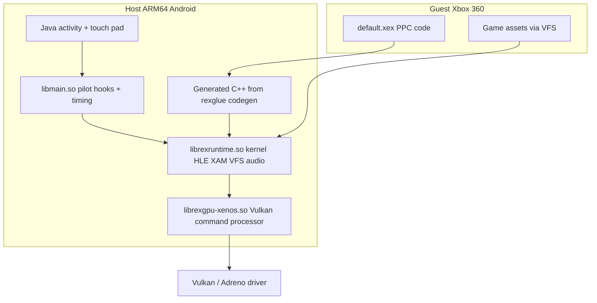

# Architecture overview

## Goal

Run the Xbox 360 PowerPC machine code of *Sonic the Hedgehog 4: Episode I* as **native AOT-compiled
C++** on a **host runtime** that emulates the console kernel, file layout, audio, and GPU (Xenos) via
modern APIs—primarily **Vulkan on Android**.

## High-level diagram

## Major components

### ReXGlue SDK (`third_party/rexglue-sdk/`)

Integrated recompiler and runtime (Xenia lineage):

| Layer | Responsibility |
|-------|----------------|
| `rexglue codegen` | PPC → C++ AOT, function table, switch/jump detection |
| Kernel / XAM HLE | Threads, synchronization, file API, video mode |
| GPU plugin | PM4 ring, register file, pipelines, textures, EDRAM paths |
| Vulkan backend | Deferred command buffers, render target cache, presenter |
| Audio | XMA decode path via FFmpeg integration |
| SDL3 | Window, input, (Android lifecycle via app glue) |

**This repository vendors a modified SDK** with Android performance work (see
[../performance/CURRENT_STATUS.md](../performance/CURRENT_STATUS.md)).

### Pilot project (`pilot/`)

- `sonic4_manifest.toml` — entry XEX and codegen output directory
- `src/main.cpp` — application entry, hooks guest main loop pacing
- `src/sonic4_timing_hooks_retail.cpp` — lightweight probes (`PROBE RENDER_VK`, frame stats)
- `src/sonic4_android_pad.cpp` — JNI touch → virtual SDL gamepad
- `generated/` — **local only** (from `rexglue codegen`, not in git)

### Android shell (`android/`)

Manual APK pipeline (no Gradle): compile Java, `aapt2` link manifest, pack `libmain.so`,
`librexgpu-xenos.so`, `librexruntime.so`, `libc++_shared.so`.

## Execution model

1. Host loads guest XEX image into 32-bit guest address space (`0x82000000` for this XBLA).
2. AOT functions take `PPCContext&` and guest base pointer; indirect calls use generated function
   table.
3. GPU thread translates PM4 packets to Vulkan command streams; presenter composites to swapchain.
4. Guest expects periodic vblank interrupts; pacing uses host monotonic clock options (`vblank_*`
   cvars).

## Build architecture

- **Host tools**: `rexglue.exe` (Windows x64) runs codegen during Android cross-build.
- **Android libs**: ReXGlue CMake preset `android-aarch64` produces `librexruntime.so`.
- **Single CMake graph**: `pilot/CMakeLists.txt` includes `generated/rexglue.cmake`.

## Windows path

Same pilot targets Windows D3D12 via ReXGlue presets (`win-amd64-release`). Status: see README
(validation lagging behind Vulkan work).

## Further reading

- Historical planning (Portuguese): [../development/LEGACY_PLANNING.md](../development/LEGACY_PLANNING.md)
- Original detailed pipeline notes: `ARCHITECTURE.md` at repository root (archived context)